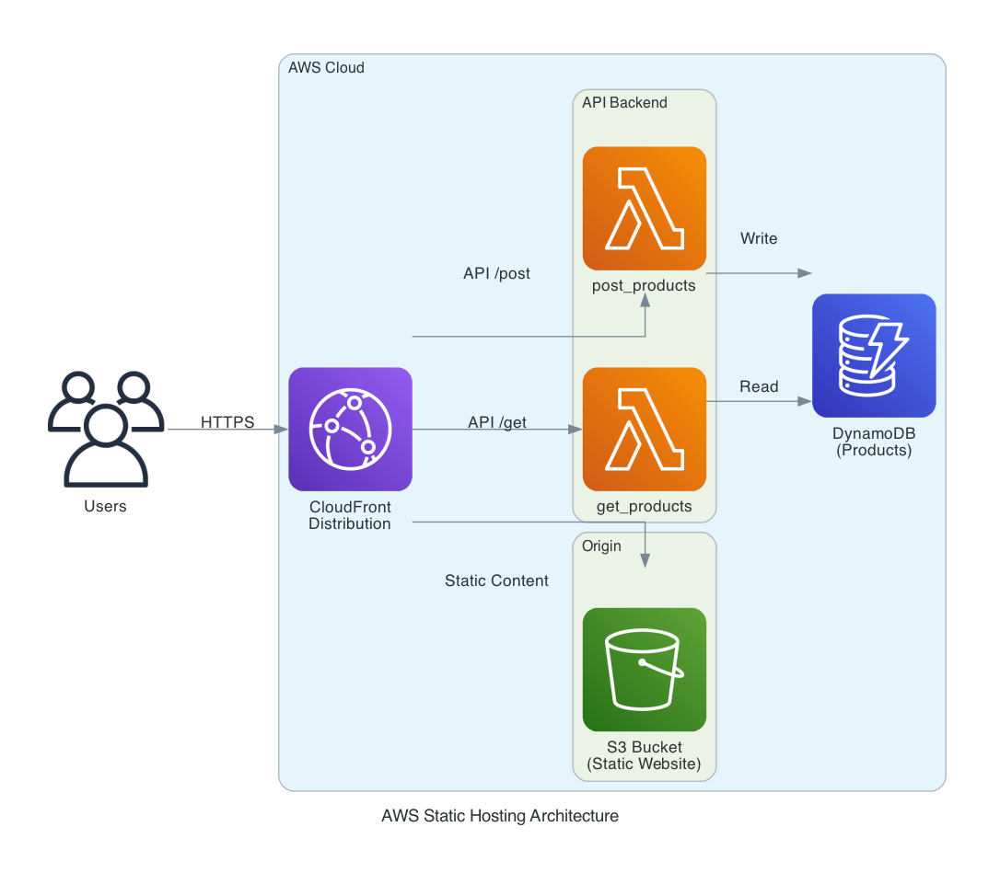

# AWS Static Hosting with CloudFront

Terraform project for provisioning static website hosting on AWS S3 with CloudFront CDN distribution, Lambda functions, and DynamoDB backend.

## Infrastructure Overview

This project provisions the following AWS resources:

| Resource | Description |
|----------|-------------|
| S3 Bucket | Static website hosting |
| CloudFront Distribution | Global CDN with HTTPS support |
| DynamoDB Table | Product data storage |
| Lambda Function (`get_products`) | Read items from DynamoDB |
| Lambda Function (`post_products`) | Write items to DynamoDB |

### Architecture Diagram



## Project Structure

```
src/
├── infra/                      # Terraform configuration files
│   └── variables/              # Environment-specific tfvars files
├── infra-modules/              # Reusable Terraform modules
│   ├── dynamodb_table/
│   ├── iam_role_policy/
│   ├── lambda_function/
│   ├── lambda_function_url/
│   ├── s3_bucket_private/
│   ├── s3_object/
│   └── s3_object_template/
├── lambda-function-python/     # Python source code for Lambda functions
├── lambda-function-python-zip/ # Generated Lambda deployment packages
└── web-template/               # Static web assets for S3
```

## Prerequisites

- [Terraform](https://www.terraform.io/downloads) >= 1.0
- [AWS CLI](https://aws.amazon.com/cli/) configured with appropriate credentials
- An AWS account with permissions to create the required resources

## Usage

All Terraform commands should be run from the `src/infra` directory.

### Workspace Setup

Create a new workspace for your environment:

```bash
terraform workspace new <environment>
```

Switch between existing workspaces:

```bash
terraform workspace select <environment>
```

### Deploy Infrastructure

Initialize Terraform:

```bash
terraform init
```

To upgrade provider versions:

```bash
terraform init -upgrade
```

Review the execution plan:

```bash
terraform plan -var-file="variables/$(terraform workspace show).tfvars"
```

Apply the configuration:

```bash
terraform apply -var-file="variables/$(terraform workspace show).tfvars"
```

### Destroy Infrastructure

```bash
terraform destroy -var-file="variables/$(terraform workspace show).tfvars"
```

## Environments

Variable files are located in `src/infra/variables/`:

- `dev.tfvars` - Development environment
- `qa.tfvars` - QA environment
- `prod.tfvars` - Production environment

## Links:

- [Linkedin](https://www.linkedin.com/in/acarratta/)
- [Web](https://devandreacarratta.it/?utm_source=github&utm_medium=aws-terraform-static-hosting-cloudfront&utm_campaign=readme)
- [Blog](https://blog.devandreacarratta.it/en/aws-cloudfront-cdn-pop-location-terraform/?utm_source=github&utm_medium=aws-terraform-static-hosting-cloudfront&utm_campaign=readme)

### Blog Contents

- [AWS CloudFront CDN: POP Location with Terraform](https://blog.devandreacarratta.it/en/aws-cloudfront-cdn-pop-location-terraform/?utm_source=github&utm_medium=cloud-architecture&utm_campaign=terraform&utm_content=aws-cloudfront-cdn-pop-location-terraform)

## License

This project is licensed under the MIT License.
